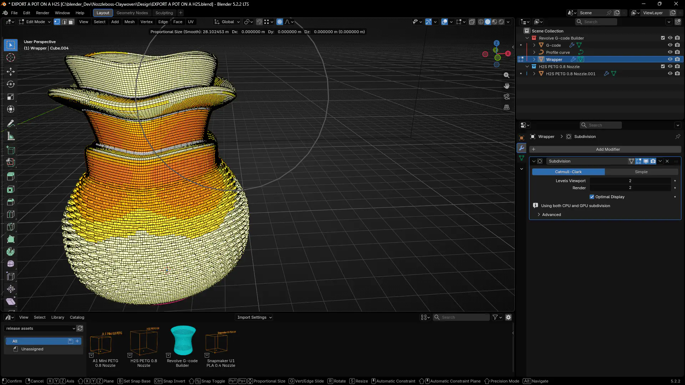
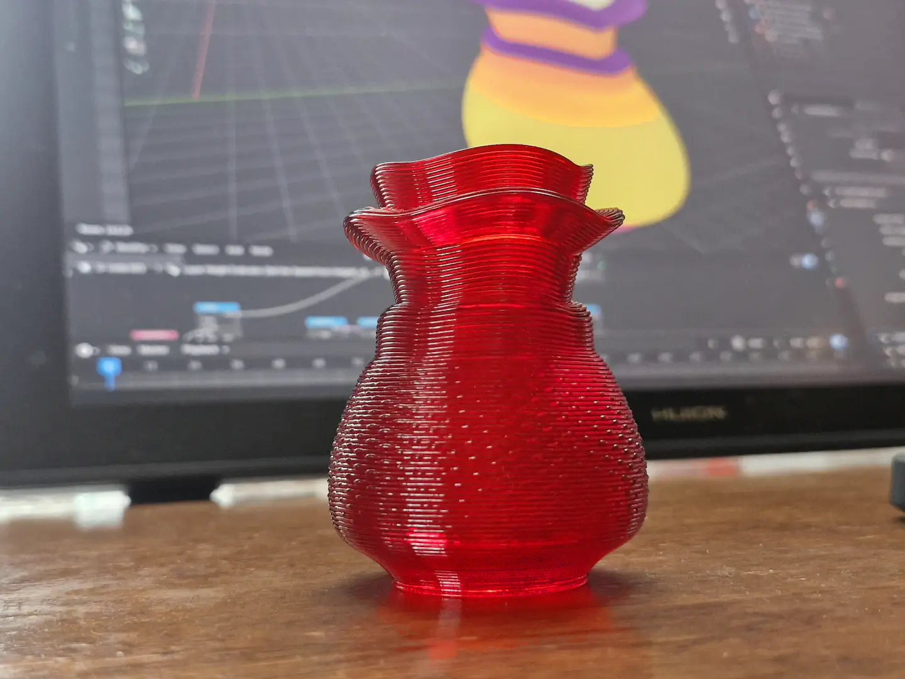

# Nozzleboss [Claywoven fork]
## Building a toolpath in Blender

This plugin is specifically built to help interpret and export toolpaths that are created in Blender. It builds on the ideas of the original [nozzleboss](https://github.com/Heinz-Loepmeier/nozzleboss) plugin by Heinz Löpmeier, which uses a ribbon to describe the path: the ribbon's height controls the layer height. This allows non-planar toolpaths, and layer heights that can be sculpted in real time in Blender.

## Build the toolpath in Blender and Settings are stored on objects, not in the exporter

Any change to the G-code toolpath is possible with either:
  - Blender's sculpting tools, to move the toolpath, or
  - Geometry Nodes, to select parts of the toolpath to modify or to build new
    spiralised contours, or change attributes such as speed and flow.

The aim is to separate the settings that shape the G-code from the
exporter as much as possible. All the data needed to rebuild your G-code toolpath is stored on objects in the .blend file. Text such as the start and end code is stored as strings in Geometry Nodes, where the exporter reads it to build the finished toolpath.

Objects are therefore much more portable: you don't depend on extra text documents that have to be kept in sync with your design. This is something I found hard to handle in the original nozzleboss

## Colour Overlays
I have added a colour overlay that lets you preview variables that are added to the toolpath, such as pauses, changes in fan speed, extrusion speed, and flow rate or custom G-code snippets. 

I have built it to be as flexible as possible, so that I (or you) can extend the functionality for new projects, by using shareable assets that build different functions that are not normally available in a slicer. While using Blender's 3D viewport to preview changes.

## I have an Asset library of Geometry Nodes groups,  on my  [Patreon](https://www.patreon.com/cw/Claywoven) that help with this process.  

The plugin is designed to be used with Geometry Nodes: you build the toolpath with the required attributes in Geometry Nodes, sculpt or stretch the path as you want, then export using nozzleboss.

To make this simple, I have built node group assets that automate the building and modification of the toolpath.  

- **Spiralise contour builder.**
Builds a spiral contour with or without a base that can be used as an object on its own or as a part of a larger design
- **Stitch maker**
Create stitch patterns that are applied to the G-code
- **G-code snippet inserter**
lets you create custom G-code, that can reference face attributes. The asset adds a mask to faces that marks where the snippet is added to. This is all stored on the node group and the toolpath, and can be adapted to your own asset, for specific purposes, such as adding layer change data, or switching on additional fans at specific points. You can also add tool changes here, though it is not completely suited for tool change; this needs to be added as part of the printer object, and will be in my next update.   
- **Wrapper builder** 
Builds a matching mesh in Geometry Nodes linked to the G-code with a Surface Deform modifier, so that you can convert the wrapper to a mesh object and sculpt it, and the changes take effect on the G-code, without having to apply the G-code builder modifier

- **Printer Objects**
That can save presets for different printers to be reused in any project. They can also share settings with multiple G-code objects at the same time.

## Printer objects

Preset printer objects store the start/end code and any other printer-specific information. They can be shared as assets, dragged and dropped into your 3D scene, and connected to your G-code objects.

This makes setup faster and complex builds easier. You can connect more than one object to the same printer to choose what gets printed.
Select the printer and press Export to get a single G-code file containing every connected object. Temporarily hide an object in the viewport and the exporter ignores it.

For example,  test print the first part of a multi-part print by hiding the rest, exporting and printing, then unhide the rest when you're ready.

## Hard-coded export settings

- A few settings are still hard-coded into the exporter.
- Z hop: the exporter tracks the highest point printed so far and lifts the
  toolhead above it for any large travel move, to try to avoid collisions.
- Don't rely on this without checking: the toolhead, part cooling fans and
  gantry can still get in the way and crash into the print.

## Geometry Nodes attributes

This is built using face and edge attributes:

  - **Face number** (face) - the faces in order, from first to last printed.
  - **Tool path** (edge) - the top edge of the ribbon: the nozzle path.
  - **Use for height** (edge) - the vertical edge at each path point; its
    length is the layer height.

These values, among others are checked by the exporter and used to calculate the G-code move. My node groups also create other attributes, like:
  - **Layer** - one number on all faces per revolution of the ribbon.
  
You can use these Geometry Nodes attributes to pick out specific layers, or specific groups of geometry within a layer, and then use those selections to add features such as offsets, over-extrusion, or any other feature you need to add

## More documentation
- [More Details](docs/more-details.md): how to install and overview of the interface  
- [Printer setup](docs/printer-setup.md): linking an object to a printer, Start and End
  G-code, retraction, line width and travel speed
- [Inserting G-code](docs/gcode-snippets.md): G-code snippets at selected faces, and the
  G-code Snippet Insert modifier
- [Building your own node tree](docs/building-your-own.md): the attributes the export
  reads, how flow, speed, fan and travel moves are written, and several objects in one file
- [Editing values by hand](docs/editing-by-hand.md): changing values on faces after applying
  the modifiers
- [Legacy colour files](docs/legacy-colour-files.md): files made with the original
  nozzleboss colour workflow

## Limitations
- Only supports relative extrusion: the export writes `G90` and `M83` after the start G-code,
  whatever the start code or its macros left.
- Assumes 1.75 mm filament.
- The .gcode file is saved next to the current .blend file.
- This is not a slicer: it exports toolpaths you build in Blender, not an STL.

## Credits
Based on [nozzleboss](https://github.com/Heinz-Loepmeier/nozzleboss) by Heinz Löpmeier. The
original's [Wiki](https://github.com/Heinz-Loepmeier/nozzleboss/wiki) and
[example.blend](https://github.com/Heinz-Loepmeier/misc/blob/main/nozzleboss_blend.zip)
describe the original import and colour workflow.
For the original's development updates and how-tos, see [Twitter](https://twitter.com/nozzleboss)
and [Instagram](https://www.instagram.com/nozzleboss/).
