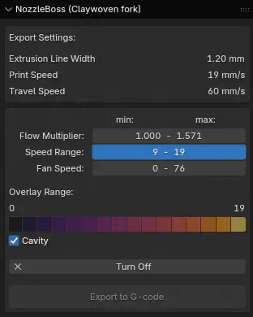
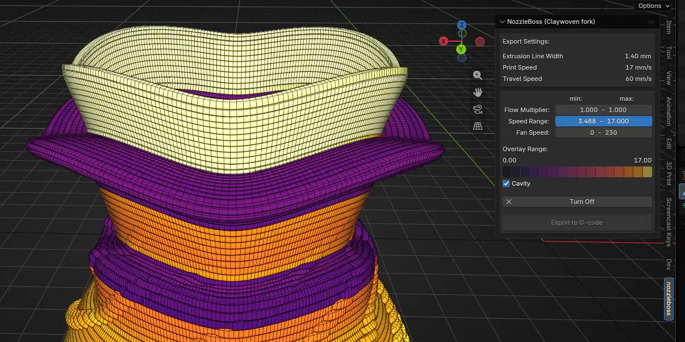

# More Details

[Back to the README](../README.md)

A Blender add-on that exports toolpaths built in Blender to G-code. **Export only:** the
original nozzleboss G-code importer has been removed.

You build an extruded-ribbon mesh with modifiers (usually Geometry Nodes). The add-on
reads the evaluated result and writes one move per segment. Flow, speed, fan and extra
G-code can change along the path.

- Exports the evaluated result of the active modifiers, without making a copy
- Exports every object linked to the same printer into one file
- Takes flow, speed, fan, Start/End G-code and inserted G-code from the node tree
- Previews any per-segment value as a colour gradient in the viewport
- On long travels and after the last move, hops above the highest point printed so far
  (no higher than the printer's build height), which makes non-planar
  prints less likely to crash. You still need to check the G-code preview and allow for
  the gantry and part-cooling fan.
- Warns if it can't save because the file is open in another program (usually a slicer
  preview)
- Still exports files made with the original nozzleboss colour workflow (see
  [Legacy colour files](legacy-colour-files.md))

Requires Blender 5.2 or later.

The Geometry Nodes assets (printer profiles and the Revolve G-code Builder) are available to
patrons on [Patreon](https://www.patreon.com/cw/Claywoven). The add-on also exports any mesh
you build yourself that follows the [attribute rules](building-your-own.md).

## Installation
- Download the GitHub repo as a .zip.
- If you are using Safari, turn off the option to open safe files after downloading.
  Otherwise Safari unzips the file, and Blender needs the add-on as a zip.
- Drag the zip file into Blender. An option to install the add-on should pop up.
- If you have the original nozzleboss add-on installed, uninstall it first. The two have
  different names, so Blender won't update one to the other. It tries to run both, which
  fails.

## Quick start
With the Claywoven assets [available on Patreon](https://www.patreon.com/cw/Claywoven):

1. Drag the **Revolve G-code Builder** and a printer (for example **A1 Mini PETG 0.8
   Nozzle**) from the Asset Browser into your scene. They come in as separate objects:
   the G-code object (what is exported), its Profile Curve and Wrapper, and the printer.
2. **Link the G-code object to the printer:** select the G-code object and, on its
   Revolve G-code Builder modifier, set **Printer** to the printer object. Without a link
   the export stops with "no printer is linked".
3. Shape the print: edit the Profile Curve, and set Add Base, Hole and Segments per Rev
   on the builder modifier.
4. Save the .blend file. The export button stays greyed out until it is saved.
5. Open the sidebar (N) and the **nozzleboss** tab. Check the values, then click
   **Export to G-code**. The file is written next to the .blend, with the same name, and
   replaces the previous export.
6. Check the G-code in your slicer's or printer's preview before printing.

The Profile Curve and Wrapper are never exported. With one of them selected, the panel
says so; select the G-code object or the printer instead.

## The panel
The add-on's panel is in the 3D View sidebar (N), on the **nozzleboss** tab.

- **Export Settings:** the linked printer's Extrusion Line Width, Print Speed and Travel
  Speed. A missing value shows as "missing" in red.
- **Values** (the box below): the selected object's min - max of Flow Multiplier, Speed Range and Fan
  Speed. Below them come the "Add G-code" stages in `_pNN` order, each with how many times
  its G-code is written and the min - max of each of its values over the masked faces. A
  missing attribute or an empty mask shows in red.
- **Export to G-code:** writes `<blend file name>.gcode` next to the saved .blend file.
  Save the .blend first.
- With the printer selected, the values cover the whole print, and the print order is
  listed below the export button. "(by name number)" shows when object names set it
  (see [Choosing the print order](building-your-own.md#choosing-the-print-order)).
- The wrapper and profile objects (`cw_prop` = `wrapper` or `profile`, on the object or its
  data) are never exported: with one selected, the panel says so and the export button is
  greyed out.

## Viewport preview
Click a value's min - max button to colour the object by that value. The colours use the
inferno gradient, from dark (low) to bright yellow (high). Click the button again, or
**Turn Off** below the gradient, to go back.

- Flow is shown from 0 to 3, speed from 0 to the object's highest speed, and fan from
  0 to 255. Masked values are fitted to their own range, and faces outside the mask
  are white. Since the speed range depends on the object, two objects can show the same
  colour for different speeds: check the range shown above the gradient.
- While the preview is on, the panel shows its range and the gradient. **Cavity** adds edge
  shading back to show the form.
- The preview switches the viewport to Solid shading with flat lighting, so the colours
  stay true. Turning it off restores your previous shading. The shading is set per
  viewport, so other objects in that viewport show their colour attributes too.
- The preview is a modifier (`NB_OverlayDisplay`) added after yours. It doesn't change the
  export, and it is deleted when the preview is turned off, so don't edit it.
- The preview is recalculated each time the node tree changes, so turn it off while
  editing a heavy node tree, and back on to check the result.

Next: [Printer setup](printer-setup.md)
